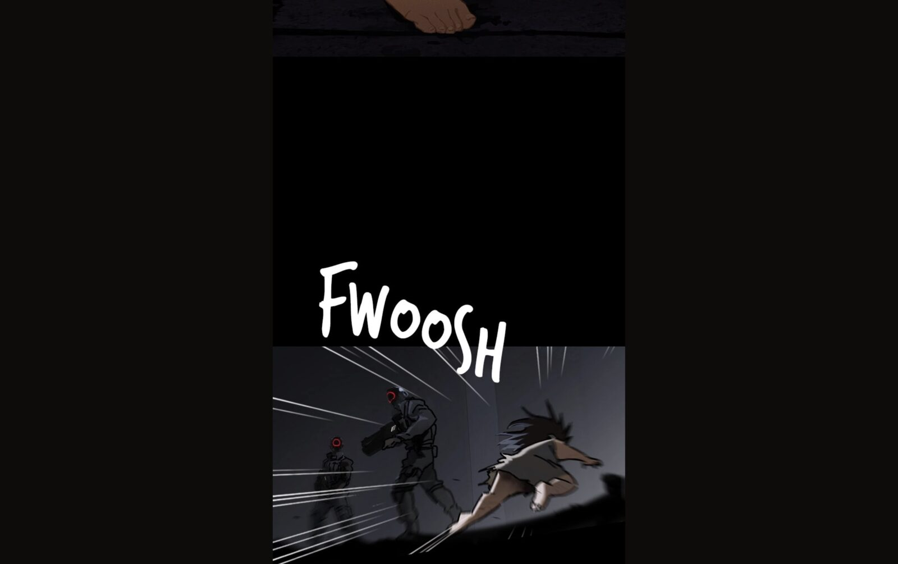

<p align="center"></p>

<h1 align="center">Nano</h1>

<p align="center">
  
  <a href="https://www.gpui.rs"></a>
  
</p>

<p align="center">
  <a href="https://discord.gg/BhgUAXHKzr"></a>
</p>

Nano is a free and open source manga reader for the desktop. It runs the same extensions as [Mihon](https://github.com/mihonapp/mihon) and Tachiyomi, so the sources you use on your phone work on your computer too. The app is native (Rust and [GPUI](https://www.gpui.rs), the UI framework behind Zed), and extensions run in a small JVM host beside it.


| Browse | Series |
|-------|-------|
|  |  |
| **Reader** | **History** |
|  |  |
| **Extensions** | **Settings** |
|  |  |

## Features

Features of Nano include:
* Mihon/Tachiyomi extensions from any repo you add, using the same address you'd give Mihon. Nano doesn't come with a repo. It remembers each repo's signing key when you add it and only runs jars signed with that key.
* Every kind of search filter an extension offers: selects, checkboxes, include/exclude tags, groups and sort orders.
* A library with what you're reading now, unread counts, and the latest chapters across your saved series.
* Three reading modes: left to right, right to left (for manga), or vertical for webtoons. Set a default in Settings, and pressing V in the reader switches between paged and vertical.
* A page scrubber with a dot per page, and a chapter list in the reader controls to jump to any chapter.
* Per-series scanlator filters, and per-extension language choices for multi-language sources.
* Migration to another source, as in Mihon. Reading progress carries over by chapter number. Series stay readable from what was saved even after their extension is removed.
* History as a grid of covers, with the chapter and page you stopped at.
* Cloudflare checks passed quietly in the built-in web engine, with a window to click only when a site insists. A FlareSolverr or Byparr you already run can be added in Settings.
* Covers cached for a week and chapter pages cached up to a size you choose, so going back doesn't download them again.
* Descriptions rendered from Markdown or HTML, with clickable links.
* Backup and restore with Mihon's `.tachibk` files: export your library, categories, progress and tracking, or import a backup from your phone. Importing only adds to what's already there.
* [SyncYomi](https://github.com/syncyomi/syncyomi) sync with Mihon forks on your phone (TachiyomiSY, Komikku), plus MyAnimeList and AniList tracking.
* JPEG XL pages (used by some sources).
* Support for the Android classes extensions lean on, such as image unscrambling, text pages, QuickJS scripts and ZIP/CBZ archives. All 1,700+ extensions in the Keiyoushi repo link against the host; whether a given source works still depends on the site.
* Bounded memory: only pages near your reading position stay decoded, and the extension host's Java heap is sized to your machine (adjustable in Settings).

## Download

Builds for macOS, Windows and Linux (x64 and ARM64) come from the Build workflow under the Actions tab. Each one includes the extension host and a small Java runtime, so you don't need to install Java.

| Platform | File |
|-------|-------|
| macOS | `.dmg` (drag Nano to Applications) |
| Windows | `.zip` (unzip and run `nano-reader.exe`) |
| Linux | `.flatpak` (`flatpak install nano-linux-x64.flatpak`), or a `.tar.gz` |

The macOS app isn't signed yet. The first time, right-click it and choose Open, or run `xattr -cr /Applications/Nano.app`.

## Building

Nano needs Rust (2024 edition) and JDK 17 or newer.

```sh
# The extension host
cd host && ./gradlew installDist

# The app (finds the host build next to it)
cd ../app && cargo run --release
```

Environment variables:
* `NANO_HOST`: path to the extension host launcher, if it isn't the dev build in `host/`.
* `NANO_DATA`: where Nano keeps its library, extensions and caches.

macOS is the most complete platform. On Windows the built-in web engine (WebView2) handles Cloudflare checks and extensions that drive a hidden WebView. On Linux the app builds and plain extensions work, but the hidden-WebView calls are not wired up yet.

## Issues, Feature Requests and Contributing

Questions and quick bug reports are welcome on [Discord](https://discord.gg/BhgUAXHKzr). Anything that needs tracking belongs in a GitHub issue.

<details><summary>Issues</summary>

Check the open issues before filing a new one. One issue per problem, please.

</details>

<details><summary>Bugs</summary>

Include your OS, the extension and series involved, and the steps that reproduce it. Logs from a terminal run (`cargo run`) help a lot.

</details>

<details><summary>Feature Requests</summary>

Describe what you want to do and why. Source requests belong in the extension repo that hosts the source, not here.

</details>

## Disclaimer

Nano isn't affiliated with Mihon, Tachiyomi or any extension repo. It doesn't host any content; extensions fetch it from third-party sites.

## License

NanoYomi is licensed under the [Mozilla Public License 2.0](./LICENSE).
