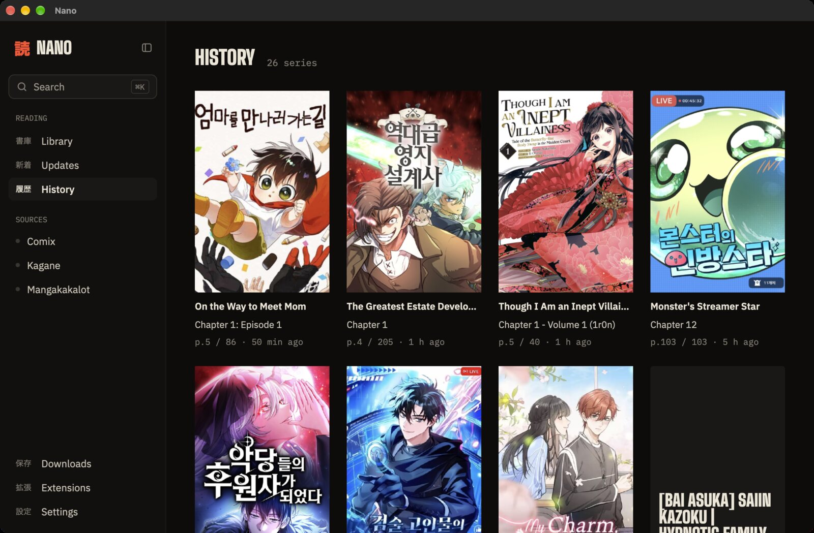
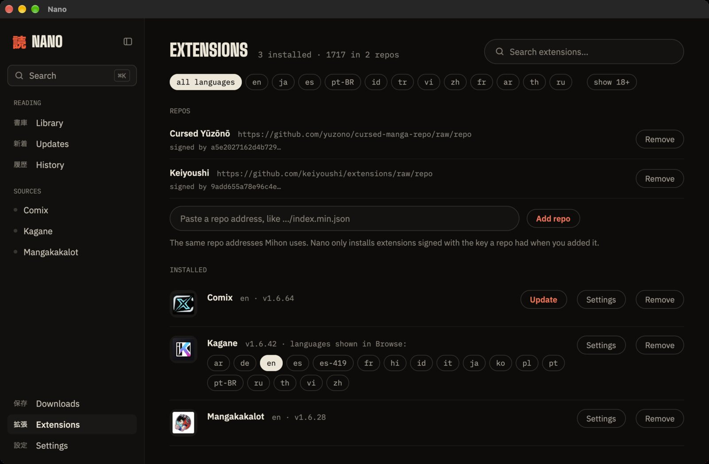
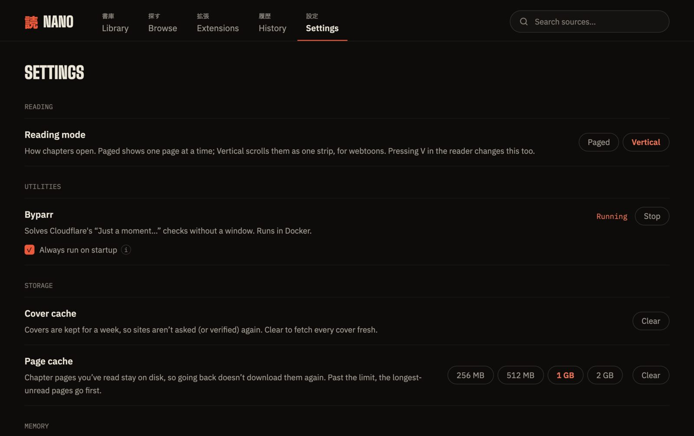

| Platforms | Built with | Extensions |
|-------|----------|----------|
|  | [](https://www.gpui.rs) |  |

# 読 Nano

Nano is a free and open source manga reader for the desktop. It runs the same extensions as [Mihon](https://github.com/mihonapp/mihon) and Tachiyomi, so the sources you use on your phone work on your computer too. The app is native (Rust and [GPUI](https://www.gpui.rs), the UI framework behind Zed), and extensions run in a small JVM host beside it.


| Browse | Series |
|-------|-------|
|  |  |
| **Reader** | **History** |
|  |  |
| **Extensions** | **Settings** |
|  |  |

## Features

Features of Nano include:
* Mihon/Tachiyomi extensions from any repo you add, using the same address you'd give Mihon. Nano doesn't come with a repo. It remembers each repo's signing key when you add it and only runs jars signed with that key.
* Every kind of search filter an extension offers: selects, checkboxes, include/exclude tags, groups and sort orders.
* A library with what you're reading now, unread counts, and the latest chapters across your saved series.
* Two reading modes: paged, or vertical for webtoons. Set a default in Settings, and pressing V in the reader changes it everywhere.
* A page scrubber with a dot per page, and a chapter list in the reader controls to jump to any chapter.
* Per-series scanlator filters, and per-extension language choices for multi-language sources.
* Migration to another source, as in Mihon. Reading progress carries over by chapter number. Series stay readable from what was saved even after their extension is removed.
* History as a grid of covers, with the chapter and page you stopped at.
* Cloudflare checks passed quietly in the built-in web engine, with a window to click only when a site insists. A FlareSolverr or Byparr you already run can be added in Settings.
* Covers cached for a week and chapter pages cached up to a size you choose, so going back doesn't download them again.
* Descriptions rendered from Markdown or HTML, with clickable links.
* JPEG XL pages (used by some sources).
* Bounded memory: only pages near your reading position stay decoded, and the extension host's Java heap is sized to your machine (adjustable in Settings).

Planned:
* [SyncYomi](https://github.com/syncyomi/syncyomi) sync with Mihon on your phone.

## Building

Nano needs Rust (2024 edition) and JDK 17 or newer.

```sh
# The extension host
cd host && ./gradlew installDist

# The app (finds the host build next to it)
cd ../app && cargo run --release
```

Environment variables:
* `NANO_HOST`: path to the extension host launcher, if it isn't the dev build in `host/`.
* `NANO_DATA`: where Nano keeps its library, extensions and caches.

macOS is the most complete platform. On Windows and Linux the app builds and plain extensions work. Extensions that drive a hidden WebView rely on WebKit calls that are only wired up on macOS so far.

## Issues, Feature Requests and Contributing

<details><summary>Issues</summary>

Check the open issues before filing a new one. One issue per problem, please.

</details>

<details><summary>Bugs</summary>

Include your OS, the extension and series involved, and the steps that reproduce it. Logs from a terminal run (`cargo run`) help a lot.

</details>

<details><summary>Feature Requests</summary>

Describe what you want to do and why. Source requests belong in the extension repo that hosts the source, not here.

</details>

## Disclaimer

Nano isn't affiliated with Mihon, Tachiyomi or any extension repo. It doesn't host any content; extensions fetch it from third-party sites.
